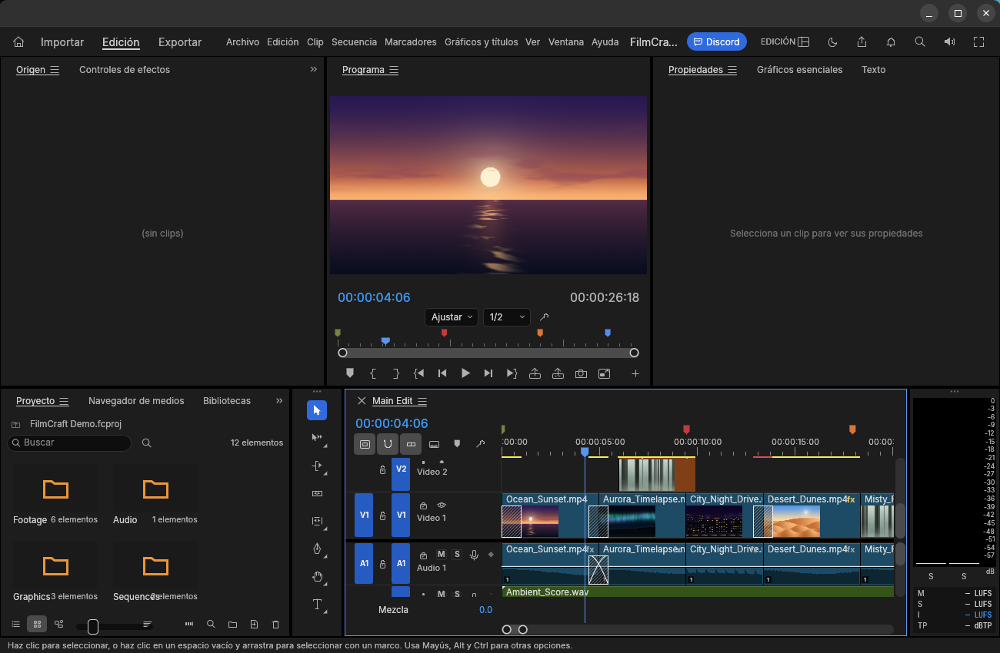
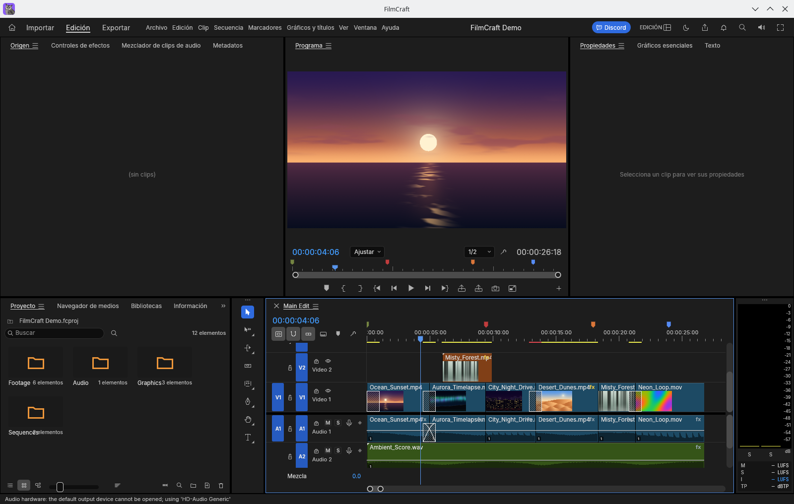

# FilmCraft window-controls review evidence

Captured on 21 October 2026 from a native debug build based on `06052cb2e41c610ba3f78737fcac37950f92cb8c`. The screenshots contain only FilmCraft, with generated demo content or an empty home screen. No user documents or desktop content are included. The tested application source is unchanged from that PR commit.

## GNOME / Wayland

GNOME Shell 51.1 / Mutter 51.0. One set of font-free Adwaita minimize, maximize/restore and close buttons is visible.

## KDE / X11

KWin 6.8.0 supplies the existing Breeze frame. The application uses X11 through XWayland, hosted by an isolated KWin Wayland compositor; this is not a full Plasma Xorg session. There is no additional client caption bar.

## Interaction checks

The same binary also ran in an isolated GNOME Shell 51.1 / Mutter 51.1 package runtime. Pointer events were confined to that private compositor. The native caption buttons maximized, restored and minimized the window; it was unminimized through the compositor, dragged by its title bar, resized by dragging the lower-right border, and closed with the native close button. The clean test process exited with status 0. This close check uses --empty --no-recover so the demo project does not produce an unsaved-project prompt.

`validation.json` records the tested source, binary hash, changed resize geometry and compositor versions. The screenshots are from the installed GNOME 51.1/Mutter 51.0 session and the KWin session; the interaction checks use the separate GNOME 51.1/Mutter 51.1 runtime. Native Windows/macOS and a complete Plasma desktop were not run.
